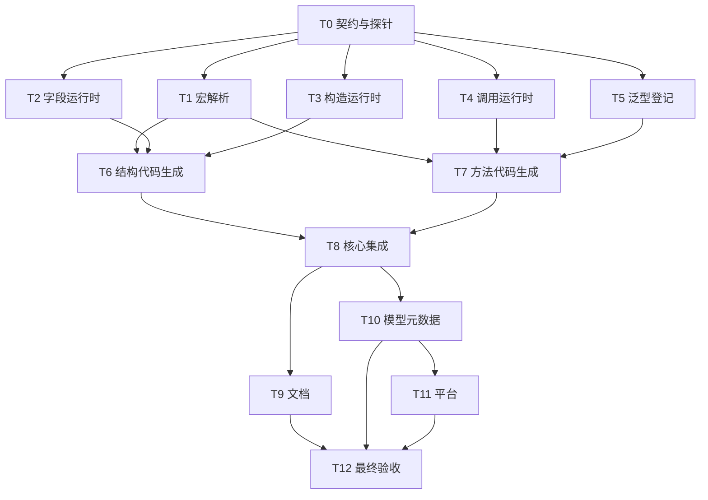

# rs-reflect 破坏性 API 重构实施计划（重建版）

> 本计划依据当前仓库状态和已确认的 API 决定重建。供协调 agent 分批派发 subagent；每项以 `- [ ]` 记录完成状态。本文落在项目内，不依赖已消失的 `/tmp/superpowers-rs-reflect-api-icAwyu`。

## 目标与已确认的 API

- `struct`、`enum`、`trait` 用 `#[Reflect]`；inherent 和 trait `impl` 用 `#[ReflectImpl]`；字段、变体、方法只用 `#[reflect(skip)]` 控制是否完全不被反射发现。删除 `#[derive(Reflect)]`、`#[reflect_impl]` 与声明上的 `specialize(...)`。
- `skip` 成员不能出现在具体描述符、泛型定义描述符、枚举/方法列表、按名称或索引的查询、注册表和调用适配器中。它不会删除原 Rust 成员，也不是保密机制。
- 字段的常见入口接收普通引用和值：`get(&T)`、`get_mut(&mut T)`、`set(&mut T, V)`；枚举分支判断为 `is_active(&T)`。动态读取返回受检视图。应用不手工创建 `ReflectedRef`、`ReflectedMut`、`ReflectedOwned`。
- 安全入口只操作公开可访问的成员；非公开字段和方法可被描述，但普通操作返回可见性错误。仅 `unsafe fn get_unsafe`、`get_mut_unsafe`、`set_unsafe`、`invoke_unsafe` 跳过可见性，仍执行精确类型、借用、Pin、枚举分支、接收者和参数检查；`skip` 不可绕过。其他能触碰非公开字段的动态读取、构造或更新入口沿用 `_unsafe` 后缀。每个 `unsafe fn` 写明调用者须维护类型不变量的 `# Safety`。
- 泛型字段随编译期已知的具体类型单态化；泛型方法声明不写具体类型。若需运行时按名称调用，在使用处以编译期确定的实例绑定到注册表。未绑定实例仍有泛型定义信息，但没有可调用入口；不得声称能从运行时 `TypeId` 生成新代码。
- 构造/更新与调用构建器接受普通值、普通借用；保留异构输入、精确类型检查、借用输出、future、Pin 和执行前的输入恢复。`FieldSetFailure<V>` 保留未消费的 `V`。`set` 是唯一普通替换名称；动态 `Box<dyn Any>` 输入按盒内实际类型校验，字段本身为盒时保持精确类型语义。
- 删除声明级 `thread_safe`、`set_thread_safe` 等单独动态入口和应用级 `SendReflected*` 模式。调用者自行加锁；跨线程传值仍受 Rust 静态 `Send`/`Sync` 约束。
- `Reflect` 运行时 trait、`TypeDescriptor::of::<T>()`、元信息查询和结构化错误类别保留。宏生成代码可在 `__private` 内使用擦除表示；根模块不再把 `Reflected*` 当作应用 API 导出。

## 当前实现快照（2026-10-13，均未当作完成验收）

| 检查点 | 证据与结论 |
| --- | --- |
| 主工作树 | `rs-reflect` 的 `dev-starfish` 位于 `402dbcc`，仍是旧 API：`derive/src/lib.rs` 有 `#[proc_macro_derive(Reflect)]`、小写 `reflect`/`reflect_impl`；`FieldDescriptor::set` 仍接收 `ReflectedMut` 与 `ReflectedOwned`；方法仍为 `invoke_local`。 |
| 已保存的实施改动 | `6827277`（`refactor(reflect): prepare unsafe visibility APIs`）只把 `src/lib.rs` 的 `#![forbid(unsafe_code)]` 改成 `#![deny(unsafe_code)]` 和 `#![deny(unsafe_op_in_unsafe_fn)]`。该提交在 `codex/rs-reflect-api-v3-t0` 至 `t9` 分支上，**不在**当前主工作树；不能把它视作整个 T0 已完成。 |
| 丢失的临时工作树 | `git worktree list --porcelain` 中 T0–T9 的路径均指向已不存在的 `/tmp/superpowers-rs-reflect-api-icAwyu/worktrees/...`，条目为 `prunable`。没有证据显示这些 worktree 中另有可恢复的未提交实现。不要自动 `prune`、删除分支或覆盖主工作树。 |
| 主工作树未提交修改 | `derive/src/configure/tests.rs`、`derive/src/expand/context.rs`、`derive/src/expand/dispatcher.rs`、`derive/src/parse/tests.rs` 有 28 行增加、9 行删除，当前 diff 是格式调整；仍须逐文件保留。 |
| 直接下游 | `rs-model-metadata` 和 `rs-platform` 的当前工作树为干净旧 API；前者生产代码仍使用 `Reflected*`，后者通过模型元数据与核心模块直接依赖反射。`rs-reflect/.github/workflows/ci.yml` 也检出这两个仓库。 |

### 执行前的工作树处理

1. 协调者先记录三个仓库的 `git status --short`、`git diff`、`git rev-parse HEAD`。执行任何会改变 Git 状态的操作前读取 `~/.agents/specs/git.mdc`。新 worktree 放在持久目录，例如 `/home/starfish/working/qubit/rust-common/.worktrees/rs-reflect-api-v3-<任务号>`，不能再放在 `/tmp`。检查旧失效条目及 `6827277` 与 `402dbcc` 的唯一差异；只在确认不涉及任何尚存工作后处理旧 worktree 元数据。
2. 新集成工作树从当前主分支或已核对的 `6827277` 建立；若从主分支建立，先纳入上述 lint 差异。把主工作树四个未提交文件的内容和校验值复制到对应负责者的隔离工作树，合并时逐行核对，不覆盖用户工作。
3. 每个 subagent 只写调度表列出的文件；使用独立 `CARGO_TARGET_DIR`。子智能体返回文件清单、测试命令及退出码、待处理风险。协调者在集成工作树按文件清单吸收变更并立即审查共享接口。未经用户明确要求，不执行 `git add`、`git commit`、`git push`；无需靠提交来传递子任务成果。
4. 生产代码、Rustdoc、Rust 测试的执行者分别读取适用的 `~/.agents/specs/rust-coding.mdc`、`rust-comment.mdc`、`rust-test.mdc`。不得为本任务之外的文件做格式化或清理。

## 调度图

| 任务 | 批次与前置 | 最小解锁产物 | 独占写入集合 | 聚焦验证 | 审查 |
| --- | --- | --- | --- | --- | --- |
| T0 契约与泛型绑定探针 | A；无 | 编译通过的泛型绑定方案、公开签名、lint 基线 | `doc/2026-10-13-breaking-api-refactor-plan.md` 的契约附录、`src/lib.rs`；探针放持久 worktree | `cargo check -p qubit-reflect`；探针编译/运行 | 立即 |
| T1 宏入口与 skip IR | B；T0 | 大写宏解析与完全排除的 IR | `derive/src/{lib,macros,entry}.rs`、`derive/src/{parse,ir,validate,configure}/**` | `cargo test -p qubit-reflect-derive --lib` | 立即 |
| T2 字段运行时 | B；T0 | 普通引用/值、可见性、恢复 | `src/access/**`、`src/descriptor/field_descriptor.rs`、`tests/field_api_v3_tests.rs` | `cargo test -p qubit-reflect --test field_api_v3_tests` | 立即 |
| T3 构造与变体运行时 | B；T0 | 异构输入、类型化结果、更新及辅助适配 | `src/construct/**`、`src/descriptor/{type_descriptor,variant_descriptor}.rs`、`src/descriptor/typed_view/optional_type_descriptor.rs`、`src/descriptor/impl_descriptor/{associated_const_reader,associated_const_binding_descriptor}.rs`、`src/capability/{clone_adapter,default_adapter}.rs`、`tests/construction_api_v3_tests.rs` | `cargo test -p qubit-reflect --test construction_api_v3_tests` | 批量 |
| T4 方法调用运行时 | B；T0 | 构建器、单层结果、可见性 | `src/invoke/**`、`src/descriptor/method_descriptor/**`、`tests/invocation_api_v3_tests.rs` | `cargo test -p qubit-reflect --test invocation_api_v3_tests` | 立即 |
| T5 泛型实例登记 | B；T0 | 使用处绑定具体实例的注册表接口 | `src/registry/**`、`tests/generic_binding_v3_tests.rs` | `cargo test -p qubit-reflect --test generic_binding_v3_tests` | 立即 |
| T6 struct/enum 代码生成 | C；T1、T2、T3 | `#[Reflect]` 到新运行时的完整结构路径 | `derive/src/expand/{structs,enums,construction,generics}.rs`、`tests/macro_struct_enum_v3_tests.rs` | `cargo test -p qubit-reflect --test macro_struct_enum_v3_tests` | 批量 |
| T7 trait/impl 代码生成 | C；T1、T4、T5 | `#[ReflectImpl]`、泛型绑定与方法调用贯通 | `derive/src/expand/{traits,impls}.rs`、`derive/src/expand/{traits,impls,invocation}/**`、`tests/macro_method_v3_tests.rs` | `cargo test -p qubit-reflect --test macro_method_v3_tests` | 立即 |
| T8 核心集成与旧测试迁移 | D；T6、T7 | 根导出、内部 ABI、现有 UI/跨 crate 测试迁移 | `src/lib.rs`、`src/private/**`、`derive/src/expand/{context,dispatcher}.rs`、除 T2–T7 新文件外的既有 `tests/**`、`test-crates/**` | `cargo test -p qubit-reflect --test integration_tests`；`cargo test -p qubit-reflect --test ui_tests` | 立即 |
| T9 文档与示例 | E；T8 | 英中指南和可编译示例 | `README*`、`doc/user_guide*`、`examples/**`、`derive/README*`、`test-crates/readme-examples/**` | `cargo test -p qubit-reflect --doc`；`cargo check -p qubit-reflect --examples` | 批量 |
| T10 模型元数据下游 | E；T8 | `rs-model-metadata` 在新 API 上通过测试 | `../rs-model-metadata/{src,derive/src,tests,derive/tests,benches,README*,derive/README*}/**` | `cargo test -p qubit-model-metadata`；`cargo test -p qubit-model-derive` | 立即 |
| T11 平台下游 | F；T10 | `rs-platform` 直接使用点迁移 | `../rs-platform/modules/{core,model-runtime,testkit}/**`；其他模块只读审计 | `cargo test -p qubit-platform-core`；model-runtime/testkit 聚焦测试 | 批量 |
| T12 全量集成与验收 | G；T9、T10、T11 | 三仓库验证记录和无遗漏的变更集 | 本计划的验收记录小节；真实缺陷回交责任任务 | 见 T12 验证矩阵 | 立即 |

批次 B 的 T1–T5、批次 C 的 T6–T7、批次 E 的 T9–T10 并行派发。批次 B 的测试使用手写描述符或独立探针，不能依赖尚未实现的新宏。T8 独占根导出与共享内部 ABI；其他任务需要调整它们时提交接口请求，由 T8 集成。所有任务的重型 Cargo 命令使用不同 target 目录；昂贵的 workspace 全量测试和 Clippy 只由 T12 运行。



## 分任务执行步骤

### T0：恢复基线并冻结共享契约

- [x] 核对 `6827277` 只有 crate lint 差异；在集成基线保留该差异和主工作树的四个未提交文件。`#![deny(unsafe_code)]` 与 `#![deny(unsafe_op_in_unsafe_fn)]` 允许仅在四个公开 `unsafe fn` 声明上局部 `#[allow(unsafe_code)]`，函数体不引入无关 unsafe 操作。验证 `cargo check -p qubit-reflect`。
- [x] 写独立编译探针：`#[Reflect] struct Service<T>`、`#[ReflectImpl] impl<T> Service<T>`，含 `fn pair<U>`；在使用处绑定 `Service<u8>`、`pair::<String>`，通过注册表按名称调用。另验证 const 泛型、受 trait bound 约束的 impl、trait impl、同一类型多个 impl 和跨 crate 调用。探针不得在声明写 `specialize(...)`。
- [x] 基于现有 `RegistrySnapshotBuilder` 的 `add_impl`/`add_impl_definition` 与 `inventory` 片段结构，选定可编译的公开绑定签名和生成器提供者协议；将完整函数签名、错误类型、恢复行为及泛型未绑定行为追加到本计划的“共享接口契约”小节。若编译器无法在上述情形下找到泛型 impl 提供者，立即停止依赖任务，说明被哪条 Rust 限制阻挡，先修订设计，不能默默取消动态泛型方法能力。
- [x] 冻结外部 trait 身份、dyn 适配、生成器集成等原设计尚未给出替代接口的能力：保留可用的内部语义，或者写出目标公开入口及其编译探针。任何删除都要在合同审查时明确，不能由叶子任务自行决定。

### T1：宏入口、解析、IR 与 skip

- [x] 先写解析与 UI 测试：大写 `#[Reflect]` 接受 struct/enum/trait，`#[ReflectImpl]` 接受 inherent/trait impl；四种成员位置的 `#[reflect(skip)]` 保留 Rust 声明但不进入反射 IR。覆盖 `cfg`/`cfg_attr`、重复和错误位置，错误指向对应属性。
- [x] 在 `derive/src/lib.rs`、`macros.rs`、`entry.rs` 和解析/校验模块实现新宏入口；把 `rename`、`readonly`、`no_construct`、`default`、`thread_safe`、`specialize` 等已删除应用选项变为明确诊断。T0 保留的高级能力不能被这一步误删。
- [x] 运行 `cargo test -p qubit-reflect-derive --lib`，检查已有未提交的 `derive/src/{configure,parse}/tests.rs` 修改未丢失。交付 T6/T7 所需的 IR 字段和 skip 索引规则。

### T2：字段访问与错误恢复

- [x] 写独立测试：公开字段对普通 `&T`/`&mut T` 的 get/get_mut/set；目标类型、字段类型或枚举分支错误不改目标；执行前的 `FieldSetFailure<V>` 原样返还 `V`，包括 `Box<dyn Any>` 动态输入。
- [x] 写可见性测试：私有、`pub(crate)`、`pub(super)` 字段在普通入口得到结构化可见性错误；`unsafe { get_unsafe / get_mut_unsafe / set_unsafe }` 能访问但仍做类型与分支检查。动态读取视图保留 type/downcast/`str` 能力；`skip` 不产生字段描述符。
- [x] 实现内部擦除桥接与公开类型化入口，删除字段 `_thread_safe` 应用入口。每个 `_unsafe` 方法写明调用者须保持类型不变量的 `# Safety`；本地运行 `cargo test -p qubit-reflect --test field_api_v3_tests`。

### T3：构造、更新、枚举及辅助适配

- [x] 写独立测试：`NamedConstructionInput::new().field("id", 1_u64).field("name", String::from("Ada"))` 与 tuple `.value(...)`；具体结果、`Box<dyn Any>` 动态结果、形状错误、重复/缺失/错误类型、执行前 `ConstructionRecovery` 的顺序和字段名。
- [x] 实现 `TypeDescriptor`/`VariantDescriptor` 的 struct/tuple/unit 构造与 struct 更新；安全入口不能间接写私有字段，`_unsafe` 变体仍执行所有形状和类型检查；`skip` 字段不要求输入且不可指定。`variant.is_active(&value)` 接受普通引用。
- [x] 将 optional 投影、Clone/Default 适配器和关联常量 reader 调整为普通输入与类型化输出；检查旧错误类别与精确 `TypeId`。运行 `cargo test -p qubit-reflect --test construction_api_v3_tests`。

### T4：调用构建器与方法权限

- [x] 写独立测试：`Invocation::receiver_mut(&mut value).arg(owned).arg_ref(&borrowed).named_arg("name", other)`；关联函数、owned/shared/mut receiver、Pin、async、借用/owned/future 输出。Rust 借用生命周期仍由编译器约束。
- [x] 实现 `method.invoke(registry, invocation)` 与 `unsafe { method.invoke_unsafe(...) }`；普通入口拒绝私有方法，`_unsafe` 仅绕过可见性。输入校验与入口不可用统一为单层结果，执行前恢复全部未消费的 receiver 和参数；未绑定泛型实例有独立不可用原因。
- [x] 删除应用手工构造 `InvocationArg` / `InvocationReceiver` 的要求及单独 `_thread_safe` 调用模式；内部动态值、Pin 和 future 语义保留。运行 `cargo test -p qubit-reflect --test invocation_api_v3_tests`。

### T5：泛型实例在使用处绑定

- [x] 用 T0 已编译通过的提供者协议实现注册表入口，保留 `RegistrySnapshotBuilder` 的事务校验、冲突诊断、固定顺序与同一快照查询/调用约束；不在运行时凭 `TypeId` 请求新的单态化。
- [x] 测试 `Service<u8>` 与 `Service<u16>`、`pair::<String>`、const 泛型、受约束 impl、多 impl、跨 crate；未绑定实例可查询泛型定义但不可调用。重复绑定按 T0 契约去重或报结构化冲突。
- [x] 运行 `cargo test -p qubit-reflect --test generic_binding_v3_tests`；向 T7 交付具体生成器签名及片段身份规则。

### T6：结构、枚举、构造代码生成

- [x] 测试 `#[Reflect]` 在公开/私有/受限字段、元组/单元/枚举、泛型字段、不实现 `Reflect` 的字段、`cfg`/`cfg_attr` 和 skip 上产生的描述。skip 字段与变体在定义及具体视图、按名称/索引查询和适配器中均不存在。
- [x] 改造 `derive/src/expand/{structs,enums,construction,generics}.rs` 以调用 T2/T3 新适配器；不再生成 `rename`、`readonly`、`no_construct`、`default`、`thread_safe` 对应的应用策略。运行 `cargo test -p qubit-reflect --test macro_struct_enum_v3_tests`。

  skip 构造策略：反射 IR 不保留 skipped Rust 字段，因此生成的 struct literal 无法安全地初始化该字段。Rust 宏无法在不额外约束用户类型的情况下判断字段是否实现 `Default`。为避免臆造初值或对 `#[Reflect]` 增加隐藏 `Default` 约束，含 skipped field 的 struct/variant 保留反射描述，但其动态构造能力标记为 unavailable；该字段不进入输入、描述符或查询。

### T7：trait、impl 与调用代码生成

- [x] 测试 `#[Reflect] trait`、`#[ReflectImpl]` inherent/trait impl、trait/impl 各自的 skip、公开/私有方法、默认 trait 方法、泛型/const 泛型与 T5 绑定。trait 声明上的 skip 从该 trait 的实现记录排除方法，某个 impl 的 skip 不删除 trait 声明。
- [x] 将 `derive/src/expand/{traits,impls,invocation}` 对接 T4/T5；删除声明级特化生成路径，但保留泛型定义信息和结构化不可用原因。验证借用参数、async、Pin、关联项及条件编译。运行 `cargo test -p qubit-reflect --test macro_method_v3_tests`。

### T8：核心集成、导出与旧测试迁移

- [x] 审查并吸收 T1–T7；由本任务统一修改 `src/lib.rs`、`src/private/**`、`derive/src/expand/{context,dispatcher}.rs`。根模块导出大写宏与同名 `Reflect` trait，不再导出应用级 `Reflected*`；生成代码通过 `__private` 取得内部适配器。保留 T0 lint 边界和四个原有未提交文件修改。
- [x] 逐个迁移现有 access/construct/invoke/descriptor/registry、UI 和 `test-crates` 夹具。旧 skip 可发现、rename、readonly、specialize 与线程安全动态模式的测试改为新行为；不批量接受 `.stderr`，也不删除仍需支持的测试语义。
- [x] 运行 `cargo test -p qubit-reflect --test integration_tests`、`cargo test -p qubit-reflect --test ui_tests`、`cargo check -p qubit-reflect --all-features`、`cargo check -p qubit-reflect --no-default-features`。失败先定位责任边界，再交原任务修复。

### T9：英中文档、Rustdoc 与示例

- [x] 更新 `README.md`、`README.zh_CN.md`、`doc/user_guide.md`、`doc/user_guide.zh_CN.md`、`derive/README.md`、`examples/**` 与 README 示例 crate。示例中的普通字段必须真的 `pub`，私有成员必须展示 `_unsafe` 及安全前提；移除旧包装值、旧宏和声明级特化用法。
- [x] 英中版都解释 skip 完全排除、泛型使用处绑定、失败恢复、动态 `Box<dyn Any>` 和调用方自行加锁；运行 `cargo test -p qubit-reflect --doc`、`cargo check -p qubit-reflect --examples`、`cargo check --manifest-path test-crates/readme-examples/Cargo.toml`。

### T10：迁移 `rs-model-metadata`

- [x] 用 `rg` 清点生产、宏生成、测试和 bench 中对 `#[derive(Reflect)]`、`reflect_impl`、`Reflected*`、旧 `set` 与旧调用入口的依赖。重点先改 `src/__private.rs`、`src/property.rs`、`src/property_access_path.rs`、`derive/src/expand/model_impl.rs`。
- [x] 模型元数据层的 `PropertyValue`、`SetterAdapter` 若仍需类型擦除，使用该层自己的受控表示或标准 `Box<dyn Any>`；不要求反射库恢复旧根导出。模型层业务约束独立于结构反射。随后迁移该仓库测试、README、bench。
- [x] 运行 `cargo test -p qubit-model-metadata`、`cargo test -p qubit-model-derive`，重点核验 property path 写入失败时仍能恢复输入。

### T11：迁移 `rs-platform` 并核查剩余直接消费者

- [x] 清点平台中直接使用新反射 API 的文件，重点为 `modules/core/src/util/{reflected_json,json_codec_registry}.rs`、`modules/core/src/model/{reflect_property,compiled_json_property_path}.rs`、`modules/model-runtime/src/lib.rs` 与 `modules/testkit/**`。迁移相关测试，保留 JSON/property path 与业务错误语义。
- [x] 运行 `cargo test -p qubit-platform-core`、`cargo test -p qubit-platform-model-runtime`、`cargo test -p qubit-platform-testkit`。若其他平台模块确有直接使用点，先扩展任务写入集合，再分配给独立执行者。
- [x] 核查 `rs-event-bus-redis-validation/rs-model-metadata` 这一嵌套检出是否实际参与构建。当前其相邻目录没有 `rs-reflect`，不要因名称相似而盲目迁移；若有真实依赖和可构建路径，再新增独立迁移任务。

### T12：最终验证与交付

- [x] 检查全部子任务差异、文件范围、原有四个未提交修改与 T0 lint 改动；用 `rg` 审核公开示例中不再要求旧宏、`specialize(...)`、`Reflected*` 或 `_thread_safe`。
- [x] 在核心集成工作树运行 `cargo test --workspace --all-features`、`cargo test -p qubit-reflect --no-default-features`、`cargo clippy --workspace --all-targets --all-features -- -D warnings`、`RUSTDOCFLAGS='-D warnings' cargo doc --workspace --no-deps`。下游两个仓库分别运行 T10/T11 聚焦测试和自身 workspace 测试；昂贵命令只在此集成节点运行一次。
- [x] 将各命令、退出状态、未解决限制和确需后续迁移的仓库记录到本文“验收记录”。所有目标 API、直接下游和必需验证完成后才宣称实施结束；未经用户要求不 add/commit/push。

## 共享接口契约

T0 已通过端到端实现与测试。由于注册 ABI 本身无法从任意方法项产生动态 adapter，最终采用显式签名 proc macro `bind_method!(path as fn(...))`：在调用 crate 生成静态单态化 adapter，再通过 `RegistrySnapshotBuilder::add_method_binding` 收集。测试覆盖泛型 impl/方法参数、const 参数、trait UFCS、同名 trait 方法消歧及跨 crate 调用。运行时只解析具体绑定，不从 `TypeId` 合成代码。

已冻结并由 T5/T7 端到端测试验证的绑定形状：

```rust
let binding = bind_method!(
    Service::<u8>::pair::<String>
        as fn(&Service<u8>, String) -> String
);
let mut builder = RegistrySnapshotBuilder::new();
builder.add_method_binding(binding, source);
let registry = builder.build()?;
```

宏在调用 crate 展开为显式具体方法实例及擦除 adapter；签名由 Rust 编译器检查，宏不得依赖运行时 `TypeId` 生成代码。impl 泛型参数与方法泛型参数分别记录，const 参数保留为 const `GenericArgument`；trait impl 使用 UFCS 确定 trait 身份。绑定按具体目标类型、impl/trait 声明身份和方法声明身份匹配，不可仅按名称匹配。重复绑定规则、稳定声明身份表示、错误类型及失败恢复必须由端到端测试确认；在确认前不能宣称这些接口已完成。若探针发现声明身份无法稳定匹配，应先修订本节，再由 T5/T7 实施。

实现为 `MethodBinding::inherent/trait_method` 与 `RegistrySnapshotBuilder::add_method_binding(binding, source)`。trait binding 使用结构化 trait application `TypeExpression`；注册构建阶段统一 concrete target 与 impl target expression，并存储 target、impl `FragmentIdentity`、方法 `MemberId`、impl/method generic args 和 adapter。T5/T7 聚焦测试、跨 crate 探针与完整 workspace 测试均通过。

其余已确认的应用层调用形状如下：

```rust
#[Reflect]
pub struct Customer {
    pub email: String,
    secret: String,
}

let email: &String = email_field.get(&customer)?;
email_field.set(&mut customer, String::from("i@i.com"))?;
let secret: &String = unsafe { secret_field.get_unsafe(&customer)? };
unsafe { secret_field.set_unsafe(&mut customer, String::from("new"))? };

let output = method.invoke(registry, Invocation::receiver_mut(&mut customer).arg(1_u64))?;
let output = unsafe { private_method.invoke_unsafe(registry, invocation)? };
```

异构构造和更新 builder 接收普通值并拥有输入；类型化构造以 `construct<T: Any>` 取得具体结果，动态构造返回 `Box<dyn Any>`。执行前失败的恢复对象以 `Box<dyn Any>` 保留每个未消费的原输入，并按调用顺序保留名称/位置；不得在失败时丢弃值或改写成目标字段类型。单字段 `set` 的失败仍使用 `FieldSetFailure<V>` 原样返回该字段的 `V`。

## 验收记录

执行记录（2026-10-13；核心实施分支 `codex/rs-reflect-api-v3-rebuild`，metadata 分支 `codex/rs-model-metadata-api-v3-rebuild`，platform 分支 `codex/rs-platform-api-v3-rebuild`）：

- T0–T9 核心 v3 API、宏、运行时、UI、文档、examples、bench 与 test crates 迁移完成；`bind_method!` 使用显式签名调用点 adapter。
- T10 `rs-model-metadata` 及 derive、测试、README、bench 已迁移；`cargo test -p qubit-model-metadata --all-features`、`cargo test -p qubit-model-derive --all-features`、README examples 3/3 与 metadata benches check 均通过。metadata manifest 已恢复相对依赖路径。
- T11 platform core/model-runtime/testkit、credential/person 调用点已迁移；core、model-runtime、testkit 全量包测试及 credential 3/3、person 10/10 通过。平台 manifest 已恢复相对路径。嵌套 `rs-event-bus-redis-validation/rs-model-metadata` 指向缺失的 sibling `rs-reflect` 目录且不可构建，按计划没有盲目修改。
- 此前的聚焦验证通过：核心 workspace all-features/no-default-features 测试、Clippy、Rustdoc、UI 与下游测试均通过。重启后重建 worktree 上 `.infra/bin/align-ci.sh` 通过；提高覆盖率后完整 `.infra/bin/ci-check.sh` 全部通过，包括 style、Clippy、lock/build/test、doctest、feature matrix、fuzz、package、coverage 和 audit。最终覆盖率为 functions 95.02%（1698/1787，门槛 ≥95.00%）、lines 92.86%（10790/11620，门槛 >90.00%）、regions 91.79%（12537/13659，门槛 >85.00%）；审计扫描了 Cargo.lock 中 108 个依赖。
- [x] 补足 functions coverage 门槛并重新运行 `.infra/bin/ci-check.sh`；覆盖率与全部 CI suite 均通过。
- CI 后已清理集成 worktree 的 Cargo `target`（约 38 GiB）及本轮/重构生成的覆盖率报告与临时文件，保留本计划文档。
- 核心实施 worktree `/data/working/qubit/rust-common/.worktrees/rs-reflect-api-v3-integration` 的变更已按 API 实现、迁移与覆盖率测试、文档三个主题提交，并以 fast-forward 合并到主 worktree 的 `dev-starfish`。提交和分支同步状态以 Git 历史为准。
- 泛型 ModelImpl 的 getter/setter call-site binding 尚未实现；metadata derive 对泛型 type/const ModelImpl 明确报错并有 compile-fail UI 覆盖。通用方法调用点 adapter 已支持泛型 impl/method/const binding。此限制已在下游文档记录。
- 未执行 `git add`、`git commit`、`git push`。构建产物与临时文件在最终检查后按来源清理；计划文档保留。
