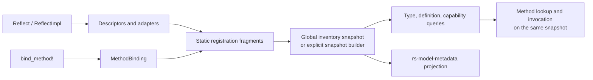

# Architecture

This document describes the current `qubit-reflect` implementation and the boundary it exposes to the in-repository `rs-model-metadata` crate. It is based on the source linked below; hidden generated-code modules are implementation protocols, not application-facing APIs.

## From declarations to a snapshot

`#[Reflect]` and `#[ReflectImpl]` parse and validate declarations, then emit descriptors, adapters, and static registration fragments. `bind_method!` emits a concrete call-site `MethodBinding` for a Rust method already monomorphized by the compiler. At registry construction, fragments are materialized and validated as a set before immutable indexes and effective method views are published.

The procedural macro entry points are in [`derive/src/lib.rs`](../derive/src/lib.rs); call-site binding expansion is in [`derive/src/expand/bind_method.rs`](../derive/src/expand/bind_method.rs). The `codegen_v3` module is a versioned generated-code protocol: its own module documentation says incompatible changes must use a sibling version rather than silently widening v3 ([`src/private/codegen_v3/mod.rs`](../src/private/codegen_v3/mod.rs)). It is not a hand-written application API.

Static fragment identities and payloads are defined in [`src/registry/fragment.rs`](../src/registry/fragment.rs). The builder validates fragments and links method bindings to exact reflected declarations ([`src/registry/registry_builder.rs`](../src/registry/registry_builder.rs)). For a normal process-wide registry, `ReflectRegistry::initialize()` sorts and validates linked inventory and publishes one immutable result. Both success and `RegistryError` are cached in a `OnceLock` ([`src/registry/reflect_registry.rs`](../src/registry/reflect_registry.rs), [`src/registry/registry_builder.rs`](../src/registry/registry_builder.rs)).

Use `RegistrySnapshotBuilder` when a caller needs an isolated snapshot assembled from explicit facts. It does not read linker inventory unless `include_linked_fragments()` is called; `build()` validates transactionally and returns no partial snapshot on error ([`src/registry/registry_snapshot_builder.rs`](../src/registry/registry_snapshot_builder.rs)). Both global and explicit snapshots are immutable after construction.

## Membership, capabilities, and calls

Concrete type membership, generic-definition membership, and capability facts are distinct registry facts. Adding a type's capabilities does not add that type to `ReflectRegistry::types()`. Queries that enumerate `type_capability_members` yield registered type members; capability-only targets are excluded. A yielded capability lookup distinguishes `Found` (a typed adapter), `FactOnly` (a declared capability without an executable adapter), and `AdapterTypeMismatch` (the same capability ID with another adapter contract). A missing target or capability is represented by absence in the relevant query ([`src/registry/registry_snapshot_builder.rs`](../src/registry/registry_snapshot_builder.rs), [`src/registry/capability_member.rs`](../src/registry/capability_member.rs), [`src/registry/reflect_registry.rs`](../src/registry/reflect_registry.rs)).

Method lookup is built into the selected snapshot's effective view. `bind_method!` supplies an already monomorphized adapter; registry construction matches it to the reflected declaration and rejects unresolved or conflicting registrations. It does not synthesize a Rust specialization from a runtime `TypeId` ([`src/registry/method_binding.rs`](../src/registry/method_binding.rs), [`src/registry/registry_builder.rs`](../src/registry/registry_builder.rs)). Pass the same `ReflectRegistry` to lookup and invocation: receiver capabilities do not fall back to another registry ([`src/registry/reflect_registry.rs`](../src/registry/reflect_registry.rs)).

Invocation binding and validation can fail before the target method runs. On these failures, `InvocationRecovery` retains the supplied receiver and arguments so the caller can inspect or reconstruct the invocation; this is not rollback for user code that has already executed ([`tests/invoke/recovery_tests.rs`](../tests/invoke/recovery_tests.rs), [`src/invoke/recovery.rs`](../src/invoke/recovery.rs)). Registry construction errors retain conflicting fragment provenance. A panic from an intrinsic capability provider propagates during explicit snapshot construction rather than becoming a `RegistryError` ([`src/registry/registry_snapshot_builder.rs`](../src/registry/registry_snapshot_builder.rs)).

## Identity and lifetime limits

`TypeDescriptor::of::<T>()` returns the descriptor supplied by `T::type_descriptor()` and checks that its `TypeId` matches `T` ([`src/descriptor/type_descriptor.rs`](../src/descriptor/type_descriptor.rs)). Generated and lazy descriptors use process-lifetime storage; for example, `LazyTypeRef` resolves once into a static `OnceLock` ([`src/private/lazy_type_ref.rs`](../src/private/lazy_type_ref.rs)). The global registry and its successful or failed initialization result also live for the process. `TypeId`, descriptor addresses, and diagnostic/query names are not portable identifiers for storage or exchange across processes. Use explicit identifiers such as `CapabilityId` or source identities such as `FragmentIdentity` where the API calls for them; a type-name lookup can return multiple candidates.

The library provides reflection metadata, typed dynamic access, registry validation, and invocation adapters. It does not provide authorization policy, application input parsing, persistence, or rollback of arbitrary application side effects.

## Downstream model projection

The repository's `rs-model-metadata` crate consumes the reflection boundary in `rs-model-metadata/src/__private.rs` and `rs-model-metadata/src/registry/model_registry.rs`. Its hidden facade re-exports `qubit_reflect::__private::codegen_v3` for generated model code. `ModelRegistry::from_reflect_registry` projects metadata capabilities by iterating the supplied snapshot's registered type and generic-definition members. It turns `FactOnly` and adapter mismatch results into model-registry errors, validates provider metadata against its descriptor, and rejects a model-metadata capability attached only to a non-member target as `UnregisteredModelTarget`. These are additional model-layer rules, not general `qubit-reflect` membership rules.

The model registry's process-wide `try_global()` separately caches its projected result or error, while its explicit constructor borrows the supplied reflection snapshot. Model-property path caches and model-ID rules belong to `rs-model-metadata`, not to the reflection registry (repository path: `rs-model-metadata/src/registry/model_registry.rs`).
