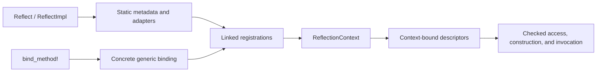

# Architecture

This document describes the vNext reflection path and the boundary available to application code. See the [English core API contract](core_api_contract.md) for a concise public contract summary; the [Chinese core API redesign](2026-10-20-core-api-redesign.zh_CN.md) remains the detailed normative specification. Generated metadata under `__private` is a versioned implementation protocol.

## From declarations to descriptors

`#[Reflect]` records structural facts from a type or trait declaration. `#[ReflectImpl]` records implementation facts and emits adapters for supported methods. `bind_method!` supplies concrete compile-time bindings for selected generic method specializations. Generated registrations are collected into a `ReflectionContext`, where conflicts are validated before aggregate indexes are published.

The derive crate owns parsing, validation, and token generation. Its output uses `qubit_reflect::__private::codegen_v4`; application code should use the public descriptors and registration macros instead of depending on this protocol directly. `#[reflect(skip)]` is the only member helper attribute: skipped declarations remain in Rust but are omitted from generated reflection metadata.

## Context and descriptor ownership

`ReflectionContext::global()` is a process-wide, lazily initialized context. `ReflectionContext::builder()` creates an independent context for explicit registration and isolation. The context validates registration facts as a whole; a failed build does not expose a partial context.

Descriptors contain static declaration metadata and a borrow of their context. A field or method reached from a descriptor therefore uses that same context. Callers do not pass a second registry to method lookup or invocation. This prevents a method resolved in one context from being invoked against another context's adapters.

Fields and variants are local declaration facts, so their views do not require aggregate context initialization. Methods, type-name discovery, trait and impl applications, and capabilities use context data. `field()` and `method()` require one result and return structured lookup errors; `fields().get()` is optional, while `lookup_method()` exposes Missing, Unique, or Ambiguous.

## Checked operations and recovery

Typed field access makes the target and field types explicit at the call site. Dynamic values are used when a framework has erased those types; the runtime checks the exact Rust type before accessing or replacing a field. A failed dynamic downcast or replacement retains the original value for recovery.

Invocation validates specialization, receiver, argument count, argument modes, and exact types before entering generated user code. Failures at this stage preserve receiver and argument inputs. Once an adapter begins, reflection cannot roll back user side effects. Panics propagate through ordinary invocation; panic capture is an explicit call-site policy.

The default value mode is `Local`. `ThreadSafe` adapters are emitted only where their Rust bounds can be proved. Erasing a local value does not make it safe to transfer between threads.

## Generic methods and capabilities

Runtime type identities cannot ask rustc to generate a new monomorphization. A generic method declaration is reflected independently from its concrete callable specializations. Applications register the specializations they support at compile time and choose one through its typed generic arguments.

Capability queries are also context-bound. Their contract includes the capability type and the adapter type, so a matching display name alone is not enough to call an adapter. Built-in capabilities rely on Rust trait bounds; custom providers use the typed registration API.

## Identity and application responsibilities

`TypeId`, descriptor addresses, context IDs, and diagnostic Rust names are process-local. They are not storage or wire-format identifiers. Applications that persist or exchange reflection references need their own stable identifiers and versioning rules.

The library provides metadata, checked dynamic operations, context validation, and generated call adapters. Applications remain responsible for input parsing, authorization, business invariants, persistence, concurrency policy, and compensation after user code has run.

## Further reading

- [English core API contract](core_api_contract.md) summarizes the public contract.
- [Core API redesign](2026-10-20-core-api-redesign.zh_CN.md) is the detailed normative API specification.
- [User guide](user_guide.md) follows a field update and method invocation from an application perspective.
- [中文架构](architecture.zh_CN.md)
- [中文用户手册](user_guide.zh_CN.md)
