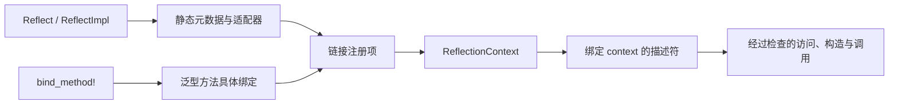

# 架构说明

本文介绍 vNext 反射流程，以及它向应用代码提供的边界。核心 API 设计文档是公开接口的正式依据；`__private` 下生成的元数据属于带版本号的实现协议。

## 从声明到描述符

`#[Reflect]` 从类型或 trait 声明中记录结构事实。`#[ReflectImpl]` 记录实现事实，并为受支持的方法生成适配器。`bind_method!` 为选定的泛型方法特化提供编译期具体绑定。生成的注册信息汇入 `ReflectionContext`，context 会先统一校验冲突，再发布聚合索引。

derive crate 负责解析、校验和生成 token。生成代码使用 `qubit_reflect::__private::codegen_v4`；应用应使用公开描述符和 registration 宏，不要直接依赖该协议。成员 helper attribute 只保留 `#[reflect(skip)]`：被 skip 的声明仍存在于 Rust 类型中，但不会进入生成的反射元数据。

## Context 与描述符的关系

`ReflectionContext::global()` 提供进程级惰性 context。`ReflectionContext::builder()` 可构建相互隔离、使用显式注册的 context。context 会整体校验注册事实；构建失败时不会暴露半成品。

描述符由静态声明元数据和 context 借用组成。从描述符取得的字段或方法会沿用同一个 context。调用方不必在方法查找和调用时再传入另一个 registry，因此不会把一个 context 中解析出的方法误用于另一个 context 的适配器。

字段和 variant 属于类型的局部声明信息，不需要先聚合 context。方法、按名称发现类型、trait/impl application 和 capability 则使用 context 数据。`field()`、`method()` 要求结果唯一并返回结构化查找错误；`fields().get()` 表示可选查询，`lookup_method()` 则返回 Missing、Unique 或 Ambiguous 的完整状态。

## 受检操作与失败恢复

typed 字段访问在调用点保留目标和字段类型。框架已经擦除类型时，可以使用动态值；运行时会在读写字段前检查精确 Rust 类型。动态 downcast 或字段替换失败时，原值会保留供调用方恢复。

Invocation 会在进入生成的用户代码前检查特化、receiver、参数数量、传递模式和精确类型。这个阶段的失败会保留 receiver 与参数。适配器开始执行后，反射无法回滚用户副作用。普通调用会让 panic 继续传播；只有调用点显式选择捕获策略时才会捕获。

动态值默认使用 `Local` 模式。只有能够证明 Rust bounds 的地方才会生成 `ThreadSafe` 适配器。擦除类型不会让本地值自动具备跨线程安全性。

## 泛型方法与能力

运行时类型身份无法要求 rustc 生成新的单态化代码。泛型方法声明的 metadata 与其可调用特化分开表示。应用在编译期注册需要支持的特化，再通过类型化泛型参数选择调用目标。

Capability 查询也绑定到 context。其契约由 capability 类型和适配器类型共同决定，因此仅有相同显示名称不足以安全调用适配器。内建 capability 依赖 Rust trait bounds；自定义 provider 使用类型化 registration API。

## 身份与应用职责

`TypeId`、描述符地址、context ID 和诊断用 Rust 名称都只在当前进程内有效，不能作为存储或网络协议标识。需要持久化或交换反射引用时，应用应定义自己的稳定标识和版本规则。

本库提供元数据、经过检查的动态操作、context 校验和生成的调用适配器。输入解析、鉴权、业务不变量、持久化、并发策略，以及用户代码执行后的补偿仍由应用负责。

## 延伸阅读

- [核心 API 设计](2026-10-20-core-api-redesign.zh_CN.md)是公开接口的正式规格。
- [用户手册](user_guide.zh_CN.md)从应用视角串起字段更新与方法调用。
- [English architecture](architecture.md)
