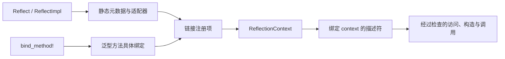

# 架构说明

本文介绍 vNext 反射流程，以及它向应用代码提供的边界。英文契约摘要见 [Core API Contract](core_api_contract.md)，详细规范仍以[核心 API 重设计文档](2026-10-20-core-api-redesign.zh_CN.md)为准；`__private` 下生成的元数据属于带版本号的实现协议。

## 从声明到描述符

`#[Reflect]` 从类型或 trait 声明中记录结构事实。`#[ReflectImpl]` 记录实现事实，并为受支持的方法生成适配器。`bind_method!` 为选定的泛型方法特化提供编译期具体绑定。生成的注册信息汇入 `ReflectionContext`，context 会先统一校验冲突，再发布聚合索引。

derive crate 负责解析、校验和生成 token。生成代码使用 `qubit_reflect::__private::codegen_v4`；应用应使用公开描述符和 registration 宏，不要直接依赖该协议。成员 helper attribute 只保留 `#[reflect(skip)]`：被 skip 的声明仍存在于 Rust 类型中，但不会进入生成的反射元数据。

## 生成代码集成协议

`__private::codegen_v4` 是供 derive crate 与下游元数据生成器协同使用的带版本集成协议，调用方必须协调 runtime 与生成器版本。受支持的表达式接口范围仅包括`ExpressionData`/`TypeExpressionData`、`GenericExpressionArgument`、`TraitExpressionData`、`LifetimeExpression`、`ConstExpression`、`FunctionPointerData`、`TraitObjectData`、`OpaqueTypeData`、`PredicateData`、`TraitBoundModifier`、`GenericParameterMetadata`、`GenericArgumentMetadata`、`GenericDefinitionMetadata`、`TypeDefinitionMetadata`、`TypeDefinitionKind`、`StructKind`、`TypeExpression`，以及用于将静态数据绑定到显式 `ReflectionContext` 的 `type_expression_in`。兼容性检查使用 `PROTOCOL_VERSION` 与 `protocol::assert_protocol_version`。该清单对应内置 derive 生成及已核查下游 derive 消费的符号；不代表 `expression` 或 `codegen_v4` 下其他项目也获得支持承诺。它不是通用应用 API，也不代表其他 codegen 模块获得支持承诺。runtime 与 derive 版本应保持一致。不兼容的协议变更须采用新的版本化命名空间，并协同更新 derive 与下游生成器；当前发布线保留 v4 符号。

复合类型描述符会为展示保留完整诊断名称。context 的短名称索引继续使用历史上的末段别名，因此复合类型的完整展示名本身不是查找键。这样既保留已有短名称查找行为，也能完整显示类型结构。

## Context 与描述符的关系

`ReflectionContext::global()` 提供进程级惰性 context。`ReflectionContext::builder()` 可构建相互隔离、使用显式注册的 context。context 会整体校验注册事实；构建失败时不会暴露半成品。

调用 `include_linked()` 或 `include_linked_for()` 时会执行链接注册工厂，而不是等到 `build()` 才执行。重复 include 或使用另一个 builder 都可能再次运行同一工厂；工厂 panic 会从 include 调用处传播，`build()` 负责报告注册和元数据错误，但不会捕获工厂 panic。全局 context 初始化期间会在不持有 context 状态锁的情况下执行这些回调。回调不得递归查询或初始化 `ReflectionContext::global()`：运行时会以 `recursive global reflection context initialization` panic 结束，而不会让同一线程等待自身。回调应只生成注册数据，并将 context 查询移到初始化完成后的应用代码中。从链接注册项构建显式 context 也可能再次调用相同回调，因此不能在回调中用它检查注册项。`include_linked_for()` 还会纳入库规定的链接全局定义和 capability；注册选择不是安全边界，也不保证排除所有无关元数据。

描述符由静态声明元数据和 context 借用组成。从描述符取得的字段或方法会沿用同一个 context。调用方不必在方法查找和调用时再传入另一个 registry，因此不会把一个 context 中解析出的方法误用于另一个 context 的适配器。

字段和 variant 属于类型的局部声明信息，不需要先聚合 context。方法、按名称发现类型、trait/impl application 和 capability 则使用 context 数据。`field()`、`method()` 要求结果唯一并返回结构化查找错误；`fields().get()` 表示可选查询，`lookup_method()` 则返回 Missing、Unique 或 Ambiguous 的完整状态。

## 受检操作与失败恢复

typed 字段访问在调用点保留目标和字段类型。框架已经擦除类型时，可以使用动态值；运行时会在读写字段前检查精确 Rust 类型。动态 downcast 或字段替换失败时，原值会保留供调用方恢复。

Invocation 会在进入生成的用户代码前检查特化、receiver、参数数量、传递模式和精确类型。这个阶段的失败会保留 receiver 与参数。适配器开始执行后，反射无法回滚用户副作用。普通调用会让 panic 继续传播；只有调用点显式选择捕获策略时才会捕获。

动态值默认使用 `Local` 模式。对于反射 struct 和 enum，字段不满足 `Send + Sync` 时可显式使用 `#[Reflect(local_only)]`，生成仅供本地使用的字段与构造适配器；裸 `#[Reflect]` 的默认行为不变。Local 值仍不能跨线程传递，该类型选项也不改变 `#[ReflectImpl]` 方法注册。只有 Rust bounds 能建立相应保证的生成路径才会提供 `ThreadSafe` 适配器。

## 泛型方法与能力

运行时类型身份无法要求 rustc 生成新的单态化代码。泛型方法声明的 metadata 与其可调用特化分开表示。应用在编译期注册需要支持的特化，再通过类型化泛型参数选择调用目标。

Capability 查询也绑定到 context。其契约由 capability 类型和适配器类型共同决定，因此仅有相同显示名称不足以安全调用适配器。内建 capability 依赖 Rust trait bounds；自定义 provider 使用类型化 registration API。

## 身份与应用职责

`TypeId`、描述符地址、context ID 和诊断用 Rust 名称都只在当前进程内有效，不能作为存储或网络协议标识。需要持久化或交换反射引用时，应用应定义自己的稳定标识和版本规则。

本库提供元数据、经过检查的动态操作、context 校验和生成的调用适配器。输入解析、鉴权、业务不变量、持久化、并发策略，以及用户代码执行后的补偿仍由应用负责。

## 迁移说明

- 显式 context 现在只包含选中的类型和显式选择的绑定目标。若应用依赖无关 linked registration 意外进入 catalog，应通过 context builder 选择所需目标。
- 非法 linked capability 会在构建 context 时报告。应用应处理 `ContextError`，不要依赖后续查询隐藏无效注册。
- 含非 `Send + Sync` 字段的反射类型可使用 `#[Reflect(local_only)]` 保留本地字段访问和构造能力；这不会让值变为线程安全。若应完全排除成员，仍可使用 `#[reflect(skip)]`。
- Rc 和 Arc 描述符现在会公开其 pointee 泛型实参；下游生产代码无需为这项元数据增量迁移。
- 调用 pinned 泛型方法时，先通过 `specialization(&MethodArguments)` 选择精确特化，再调用 `MethodSpecializationDescriptor::invoke_pinned`。校验拒绝时会保留 pinned receiver 和参数。`echo<T>(Pin<&mut Self>, T) -> T` 形式的绑定可以被发现，但泛型参数 metadata 尚不能识别具体实参类型，因此该调用仍不可执行。

## 延伸阅读

- [核心 API 重设计规范](2026-10-20-core-api-redesign.zh_CN.md)是公开接口的详细正式规格。
- [英文核心 API 契约摘要](core_api_contract.md)
- [用户手册](user_guide.zh_CN.md)从应用视角串起字段更新与方法调用。
- [English architecture](architecture.md)
