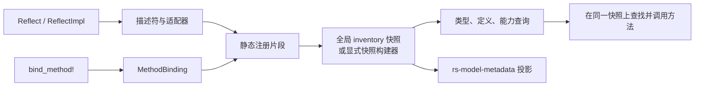

# 架构

本文说明 `qubit-reflect` 的当前实现，以及它与仓库内 `rs-model-metadata` crate 的边界。下文依据所链接的源码；隐藏的生成代码模块属于实现协议，不是应用手写 API。

## 从声明到快照

`#[Reflect]` 和 `#[ReflectImpl]` 会解析并校验声明，然后生成描述符、适配器和静态注册片段。`bind_method!` 为 Rust 编译器已经单态化的方法生成具体的调用点 `MethodBinding`。构建注册表时，系统先整体物化并校验这些片段，再发布不可变索引和有效方法视图。

过程宏入口位于 [`derive/src/lib.rs`](../derive/src/lib.rs)，调用点绑定展开位于 [`derive/src/expand/bind_method.rs`](../derive/src/expand/bind_method.rs)。`codegen_v3` 是有版本号的生成代码协议：模块文档规定，不兼容变更应新增同级版本，而不是悄悄扩大 v3 的内容（[`src/private/codegen_v3/mod.rs`](../src/private/codegen_v3/mod.rs)）。它不是应用手写 API。

静态片段的身份和载荷定义在 [`src/registry/fragment.rs`](../src/registry/fragment.rs)。构建器会校验片段，并把方法绑定连接到精确的反射声明（[`src/registry/registry_builder.rs`](../src/registry/registry_builder.rs)）。常规进程级注册表由 `ReflectRegistry::initialize()` 构建：它排序并校验链接器 inventory，再发布一个不可变结果；成功结果和 `RegistryError` 都缓存在 `OnceLock` 中（[`src/registry/reflect_registry.rs`](../src/registry/reflect_registry.rs)、[`src/registry/registry_builder.rs`](../src/registry/registry_builder.rs)）。

需要用显式事实组装隔离快照时，可使用 `RegistrySnapshotBuilder`。除非调用 `include_linked_fragments()`，它不会读取链接器 inventory；`build()` 会事务式校验，失败时不会返回部分快照（[`src/registry/registry_snapshot_builder.rs`](../src/registry/registry_snapshot_builder.rs)）。全局快照和显式快照在构建完成后都不可变。

## 成员、能力与方法调用

具体类型成员、泛型定义成员和能力事实是彼此独立的注册事实。添加某类型的能力不会把该类型加入 `ReflectRegistry::types()`。`type_capability_members` 只枚举已注册的类型成员，不包括仅有能力事实的目标。返回项中的能力查询结果区分 `Found`（有类型化适配器）、`FactOnly`（声明了能力但没有可执行适配器）和 `AdapterTypeMismatch`（能力 ID 相同但适配器契约不同）。目标或能力不存在时，相关查询会返回空值或不包含该项（[`src/registry/registry_snapshot_builder.rs`](../src/registry/registry_snapshot_builder.rs)、[`src/registry/capability_member.rs`](../src/registry/capability_member.rs)、[`src/registry/reflect_registry.rs`](../src/registry/reflect_registry.rs)）。

方法查找基于所选快照中的有效视图。`bind_method!` 提供已经单态化的适配器；注册表构建会将其匹配到反射声明，并拒绝无法解析或冲突的注册。它不会根据运行时 `TypeId` 合成 Rust 特化（[`src/registry/method_binding.rs`](../src/registry/method_binding.rs)、[`src/registry/registry_builder.rs`](../src/registry/registry_builder.rs)）。查找和调用应传入同一个 `ReflectRegistry`：接收者能力不会回退到另一个注册表（[`src/registry/reflect_registry.rs`](../src/registry/reflect_registry.rs)）。

调用绑定或校验可能在目标方法运行前失败。此时 `InvocationRecovery` 会保留调用者传入的接收者和参数，供调用者检查或重建调用；它不能回滚已经执行的用户代码（[`tests/invoke/recovery_tests.rs`](../tests/invoke/recovery_tests.rs)、[`src/invoke/recovery.rs`](../src/invoke/recovery.rs)）。注册表构建错误会保留冲突片段的来源。显式快照构建期间，内禀能力提供器的 panic 会继续传播，不会转换为 `RegistryError`（[`src/registry/registry_snapshot_builder.rs`](../src/registry/registry_snapshot_builder.rs)）。

## 身份与生命周期限制

`TypeDescriptor::of::<T>()` 返回 `T::type_descriptor()` 提供的描述符，并检查其 `TypeId` 是否与 `T` 一致（[`src/descriptor/type_descriptor.rs`](../src/descriptor/type_descriptor.rs)）。生成描述符和惰性描述符使用进程生命周期存储；例如 `LazyTypeRef` 会通过静态 `OnceLock` 只解析一次（[`src/private/lazy_type_ref.rs`](../src/private/lazy_type_ref.rs)）。全局注册表及其初始化成功或失败的结果也会存活于进程生命周期。`TypeId`、描述符地址、诊断名称和查询名称都不是可跨进程持久化或交换的标识。API 要求时，应使用 `CapabilityId` 等显式标识，或使用 `FragmentIdentity` 等来源身份；按类型名查询可能返回多个候选项。

本库提供反射元数据、类型化动态访问、注册表校验和调用适配器。授权策略、应用输入解析、持久化，以及任意应用副作用的回滚由应用层负责。

## 下游模型投影

仓库内的 `rs-model-metadata` crate 在 `rs-model-metadata/src/__private.rs` 和 `rs-model-metadata/src/registry/model_registry.rs` 使用反射边界。它的隐藏 facade 将 `qubit_reflect::__private::codegen_v3` 重新导出，供生成的模型代码使用。`ModelRegistry::from_reflect_registry` 遍历所传快照中已注册的类型成员和泛型定义成员，投影其元数据能力。它会将 `FactOnly` 和适配器类型不匹配转换成模型注册错误，校验提供器元数据与描述符是否一致，并将仅附着在非成员目标上的模型元数据能力拒绝为 `UnregisteredModelTarget`。这些是模型层的附加规则，不是 `qubit-reflect` 对成员资格的一般约束。

模型注册表的进程级 `try_global()` 会另外缓存投影结果或错误；显式构造器则借用传入的反射快照。模型属性路径缓存和模型 ID 规则属于 `rs-model-metadata`，不属于反射注册表（仓库内路径：`rs-model-metadata/src/registry/model_registry.rs`）。
