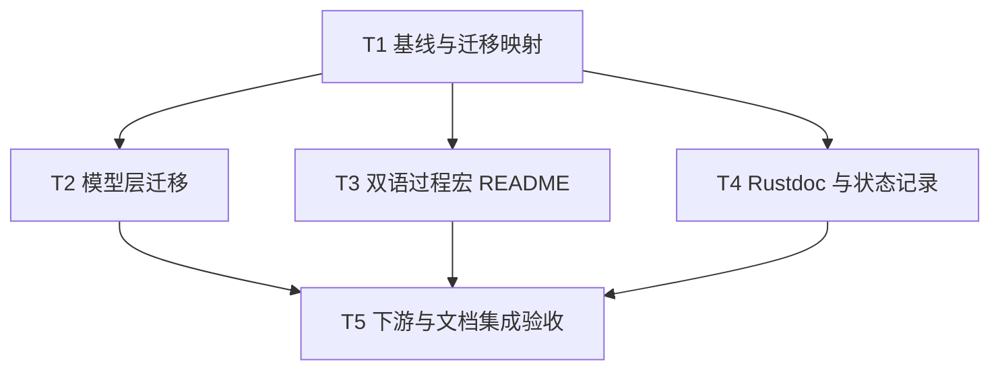

# rs-reflect v3 下游集成与文档修复实施计划

> **面向执行者：** 按本计划逐项实施并用复选框跟踪。设计依据见 [设计文档](design-20261013T092205288Z-a3ed5a44.md)。本文件是计划，不表示代码修复已经完成。

**目标：** 让当前同级 `rs-model-metadata`、`rs-platform` 与 `rs-reflect` v3 API 共同通过验证，并修正过程宏 README、Rustdoc 和历史验收状态说明。

**架构：** 保持 `rs-reflect` v3 为唯一公开契约。选择性吸收下游候选迁移代码，按模型层到平台层的依赖顺序编译；文档修复与下游迁移可独立进行，最终统一验收。

**技术栈：** Rust 2024、Cargo、过程宏、Python 文档示例检查；项目声明的 Rust 1.94 工具链。

## 全局约束与基线

- 在用户当前 Paseo workspace 内操作，不创建或打开新的 Paseo workspace。实际代码实施可按当时仓库状态选择隔离方式，但不得依赖失效的 `/tmp` 链接。
- 当前评审基线：`rs-reflect` `0cdd68c9ef3bf469e0d2a6d99a88c5b30d717b82`；`rs-model-metadata` `5fbffd8fcc22899a4c336f850344f049409a2d09`；`rs-platform` `716a5157f043ce5b8d57ad491758a62b9b6ca7aa`。执行前重新记录 HEAD、分支和 `git status --short`，状态变动时以实际内容重新核对。
- 目标公开宏为 `#[Reflect]`、`#[ReflectImpl]`、`bind_method!`。不恢复 `#[derive(Reflect)]`、`#[reflect_impl]` 或根模块的应用级 `Reflected*` 导出。
- 只修改本设计直接涉及的源码、测试和文档；保留用户现有改动。未经用户明确要求，不执行 `git add`、`git commit` 或 `git push`。需要执行改变 Git 状态的命令前先读取适用 Git 规则。
- 修改 Rust 生产代码、测试、脚本时，执行者分别读取适用的项目与全局按需规则。单纯文档修复不触发源码规则。
- 所有“通过”结论必须来自当前检出上的新鲜命令输出；历史分支的验收仅作参考。

## 文件职责与写入边界

| 范围 | 预计文件 | 责任 |
| --- | --- | --- |
| 模型层 v3 迁移 | `../rs-model-metadata/src/__private.rs`、`src/property.rs`、`src/property_access_path.rs`、`src/resolve/graph.rs`、`derive/src/expand/model_impl.rs`，以及搜索证实的同类调用点和相应测试 | 使模型门面、访问路径与生成代码使用现行 v3 契约 |
| 平台验证与必要修复 | `../rs-platform/modules/core/**`、`modules/model-runtime/**`、`modules/testkit/**` 中实际失败的调用点 | 验证已迁移代码与当前模型层集成；只修真实失败 |
| 过程宏文档 | `derive/README.zh_CN.md`，必要时 `derive/README.md` 与 `scripts/tests/check_markdown_examples_tests.py` | 修正双语公开说明与可编译示例 |
| Rustdoc 与状态 | `src/descriptor/impl_descriptor/impl_definition_descriptor.rs`、实际发现的用户可见旧入口说明、`doc/2026-10-13-breaking-api-refactor-plan.md` | 清除误导性 API 说明并准确记录当前集成状态 |

以上为预计集合；若编译或定向搜索发现其他必需文件，先记录“旧调用点 → v3 入口 → 验证”，再纳入对应任务。不得仅按文件名批量替换。

## 调度图

| 任务 | 前置任务 | 最小解锁产物 | 写入集合 | 本地验证 | 集成验证归属 | 审查时机 |
| --- | --- | --- | --- | --- | --- | --- |
| T1 基线与迁移映射 | 无 | 当前三仓库 HEAD/状态、旧入口清单、候选分支差异映射 | 只读 | `git status --short`、`rg`、`git diff`；重现模型层 `cargo check` 失败 | T5 | 立即 |
| T2 模型层迁移 | T1 | 当前 `rs-model-metadata` 的 v3 生产/生成代码及聚焦测试可编译 | `../rs-model-metadata/src/**`、`derive/src/**`、对应测试与文档 | `cargo check -p qubit-model-metadata --lib --offline`、模型层与 derive 聚焦测试 | T5 | 立即 |
| T3 双语过程宏 README | T1 | 中文示例使用现行宏且独立检查通过 | `derive/README.zh_CN.md`；必要时 `derive/README.md` 与文档检查测试 | `python3 scripts/check_markdown_examples.py derive/README.zh_CN.md derive/README.md` | T5 | 批量 |
| T4 Rustdoc 与状态记录 | T1 | 用户可见宏说明正确；历史记录与当前状态区分 | `src/descriptor/impl_descriptor/impl_definition_descriptor.rs`、发现的同类注释、`doc/2026-10-13-breaking-api-refactor-plan.md` | 定向 `rg`、`cargo test -p qubit-reflect --doc --offline` | T5 | 批量 |
| T5 下游与文档集成验收 | T2、T3、T4 | 三仓库当前检出验证结果和最终状态记录 | 仅真实失败所需的 `../rs-platform` 调用点、相应测试及 T4 状态附录 | `cargo check --workspace`、相关包测试；见下文完整门禁 | T5 | 立即 |

T2、T3、T4 在 T1 完成后可并行，写入集合不相交。Cargo 构建共享缓存时将重型命令串行运行，或明确分配互不相同的 `CARGO_TARGET_DIR`；全量 CI、Clippy、coverage、fuzz 只由 T5 执行。

## 任务拓扑依赖图

## 任务步骤

### T1：冻结实际基线并建立迁移映射

- [ ] 在三个当前同级仓库分别记录 `git rev-parse HEAD`、`git branch --show-current`、`git status --short`；如存在用户改动，先界定并保留，不以候选分支覆盖。
- [ ] 在 `rs-model-metadata` 运行 `cargo check -p qubit-model-metadata --lib --offline`，保存退出码和首个错误族；预期基线为旧 `Reflected*`/`reflect_impl` 导入失败，若已通过则重新定位剩余问题。
- [ ] 使用 `rg -n 'Reflected(Ref|Mut|Owned)|reflect_impl|#\[derive\(Reflect\)\]' src derive/src tests benches README.md README.zh_CN.md` 清点模型仓库旧公开入口；另检查平台直接使用点。
- [ ] 用 `git diff --stat dev-starfish..codex/rs-model-metadata-api-v3-rebuild`、`git diff --stat dev-starfish..codex/rs-reflect-api-v3-t10` 及针对上述文件的 `git diff` 比较候选方案。对每个迁移点记下当前 v3 对应 API、候选分支差异和是否需要移植；不把历史分支的通过记录算作当前通过。
- [ ] 确认相邻 Cargo path 指向当前真实 `rs-reflect` 检出；候选工作树中的失效符号链接仅作背景，不作为构建入口。

### T2：将当前模型元数据接入 v3

- [ ] 先让现有模型层库检查和最小宏集成测试在当前分支复现失败；选取覆盖字段读取、替换及错误恢复、`ModelImpl` 方法生成的现有测试作为回归点，记录测试名与预期结果。
- [ ] 从 `src/__private.rs` 开始，把生成代码门面改为现行 `ReflectImpl` 与 v3 动态值来源；依编译错误迁移 `src/property.rs`、`src/property_access_path.rs`、`src/resolve/graph.rs` 的普通引用/值及错误恢复调用。
- [ ] 更新 `derive/src/expand/model_impl.rs` 等实际旧宏生成点，让生成的 impl 使用 `#[ReflectImpl]`，并与当前 `qubit-reflect::__private::codegen_v3` 契约一致。逐项比较候选分支，不直接整体合并 77—80 个变更文件。
- [ ] 运行 `cargo check -p qubit-model-metadata --lib --offline`；预期退出码 0。再运行 `cargo test -p qubit-model-metadata --lib --offline` 与 `cargo test -p qubit-model-derive --lib --offline`，修复本次迁移导致的失败。
- [ ] 运行模型仓库已有的相关 UI/集成测试，特别核对泛型 `ModelImpl` 的受限诊断、属性访问与执行前输入恢复；若测试仍使用旧入口，应与生产代码一起迁移，而不是删除断言。

### T3：修复过程宏双语 README

- [ ] 先运行 `python3 scripts/check_markdown_examples.py derive/README.zh_CN.md`，确认现有 `#[derive(Reflect)]` 示例失败；保存诊断作为回归基线。
- [ ] 把 `derive/README.zh_CN.md` 的宏清单、Quick Start 与 trait/impl 说明更新为 `Reflect`、`ReflectImpl`、`bind_method!`；示例使用 `#[Reflect]`，并与英文 README 的事实、限制和语言链接逐项核对。保留自然中文，不逐句直译。
- [ ] 运行 `python3 scripts/check_markdown_examples.py derive/README.zh_CN.md derive/README.md`；预期所有 Rust 块通过。再执行 `python3 scripts/check_document_contracts.py` 验证链接与已声明事实。
- [ ] 若检查器遗漏本次发现的文档范围，才对 `scripts/tests/check_markdown_examples_tests.py` 增加能实际检出该遗漏的测试；现有编译检查已覆盖时不写重复测试。

### T4：修正 Rustdoc 与历史计划状态

- [ ] 对当前源码 Rustdoc、README、用户指南定向搜索旧公开宏名与应用级旧包装类型；逐条区分用户用法、内部函数名、真实保留的 `invoke_local` 与历史叙述。
- [ ] 将 `src/descriptor/impl_descriptor/impl_definition_descriptor.rs` 的 `#[reflect_impl]` 用户说明更正为 `#[ReflectImpl]`；其他经确认的用户可见残留同样更正。若编译器诊断仍推荐已删除的公开宏，也按实际 parser 合同修正并覆盖对应 UI 测试。
- [ ] 在 `doc/2026-10-13-breaking-api-refactor-plan.md` 的验收记录末尾追加状态附录，写明历史记录对应实施分支、当前模型仓库基线曾失败及待 T5 填写的当前验证状态；不改写历史条目或预先宣称集成完成。
- [ ] 运行 `cargo test -p qubit-reflect --doc --offline`；预期退出码 0。对用户可见文档再次搜索，确认没有错误的旧公开入口说明。记录哪些同形内部标识或历史引用被有意保留及原因。

### T5：验证当前依赖链并收口

- [ ] 在 T2 后重新执行模型仓库 `cargo check -p qubit-model-metadata --lib --offline`，并运行 `cargo test --workspace --all-features --offline`；失败时区分迁移问题与环境问题，回到对应文件修复。
- [ ] 在当前 `rs-platform` 执行 `cargo check --workspace --offline`，再执行 `cargo test -p qubit-platform-core --lib --tests --offline`、`cargo test -p qubit-platform-model-runtime --lib --tests --offline` 和 `cargo test -p qubit-platform-testkit --offline`；实际包名先由对应 `Cargo.toml` 核对，若不同以清单为准并把精确命令写入验收记录。仅修改检查明确指出的不兼容调用点。
- [ ] 在 `rs-reflect` 运行 `python3 scripts/check_markdown_examples.py`、`python3 scripts/check_document_contracts.py`、`cargo test --workspace --all-features --offline`、`cargo test -p qubit-reflect --no-default-features --offline`、`cargo clippy --workspace --all-targets --all-features --offline -- -D warnings` 与 `RUSTDOCFLAGS='-D warnings' cargo doc --workspace --no-deps --offline`。若依赖缓存不齐，记录失败原因后按现有 CI 入口在线重跑，不把环境失败称为代码通过。
- [ ] 按项目现有 `.infra/bin/ci-check.sh` 或同等 CI 门禁完成最终验收；coverage、fuzz 等昂贵检查在此节点运行一次。记录每条命令、退出码和未运行原因。
- [ ] 检查三仓库 `git status --short` 与最终差异，确保只涉及本任务；在旧计划状态附录补入当前 HEAD、验证结果及剩余限制。只有实际全部通过时才写“当前同级检出已集成”。

## 交付核对

- [ ] 当前模型仓库不再依赖已移除的根入口，`cargo check` 与相关测试通过。
- [ ] 当前平台仓库在相同 `rs-reflect`/模型仓库组合下完成规定检查。
- [ ] 两种过程宏 README 的示例通过 Markdown 编译检查，文字与实际宏导出一致。
- [ ] 用户可见 Rustdoc 不再推荐 `#[reflect_impl]`；历史记录清楚标明分支与当前状态。
- [ ] 证据注明当前提交、命令、退出码和适用范围；未验证项目不标为通过。
