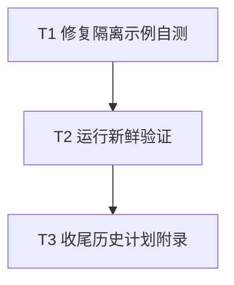

# rs-reflect CI 自测与验收记录修复实施计划

> **面向执行者：** 按下列任务的依赖关系逐项实施。复选框记录进度；只有实际运行并核对输出后，才能把对应项标记为完成。

**目标：** 让 Markdown 示例隔离自测使用当前 `#[Reflect]` API，并以新鲜验证结果收尾旧重构计划的验收附录。

**设计依据：** [本次设计文档](design-20261014T043837356Z-5a6228a2.md)。

**技术栈：** Python `unittest`、Rust 2024、Cargo、项目 CI Shell 入口、Markdown。

**工作目录：** `/data/working/qubit/rust-common/rs-reflect`。在用户当前 Paseo workspace 中执行；不得创建或打开新的 Paseo workspace。

## 全局约束

- 只改 `scripts/tests/check_markdown_examples_tests.py` 和 `doc/2026-10-13-breaking-api-refactor-plan.md` 中与本设计直接相关的内容。保留工作树已有的两份旧设计文档删除状态。
- 不增加兼容宏，不改变 `qubit-reflect` 公开 API；继续真实编译并运行两个隔离 Markdown 示例。
- 不根据旧日期的日志推断当前测试状态。验收记录写实际日期、提交标识、命令、退出码和覆盖范围；失败及未运行也必须如实写明。
- 本计划不授权 `git add`、`git commit`、`git push`，也不授权清理用户文件。构建工具正常生成的可再生产物可按项目规则处理。

## 文件与职责

| 文件 | 修改职责 |
| --- | --- |
| `scripts/tests/check_markdown_examples_tests.py` | 更新一个测试中的 Rust 代码样例，保留双示例隔离断言。 |
| `doc/2026-10-13-breaking-api-refactor-plan.md` | 保留历史验收信息，更新末尾“当前同级检出状态”的四条占位项。 |

## 调度图

| 任务 | 前置任务 | 最小解锁产物 | 写入集合 | 本地验证 | 集成验证归属 | 审查时机 |
| --- | --- | --- | --- | --- | --- | --- |
| T1：修复隔离示例自测 | 无；批次 A | 当前 API 的两个示例均编译运行 | `scripts/tests/check_markdown_examples_tests.py` | 单项 `unittest` | T2 | 立即审查 |
| T2：运行新鲜验证 | T1 | 逐项命令、退出码和范围的记录 | 无；只读运行 | 脚本测试、项目钩子、核心测试、两个下游库检查 | T2 | 立即审查；Cargo 重型命令属同一资源组，串行执行 |
| T3：收尾历史计划附录 | T2 | 与新鲜证据一致的状态记录 | `doc/2026-10-13-breaking-api-refactor-plan.md` | 占位项与差异检查 | T3 | 立即审查 |

## 任务拓扑依赖图



### T1：修复隔离示例自测

**文件：** `scripts/tests/check_markdown_examples_tests.py`，仅 `ParserTests.test_real_inventory_examples_are_isolated` 的 `source` 字符串。

- [x] **复现。** 在项目根目录运行：

  ```bash
  python3 -m unittest discover -s scripts/tests -p 'check_markdown_examples_tests.py' -k test_real_inventory_examples_are_isolated
  ```

  预期当前基线失败，诊断包含 `expected derive macro, found attribute macro Reflect`；若失败原因不同，先定位原因，不直接套用下步。

- [x] **替换样例。** 保留外层 `source + "\n" + source` 和 `self.assertEqual(MODULE.check_examples(root, [document]), 2)`，只把 Rust fenced block 改为：

  ````rust
  ```rust
  use qubit_reflect::Reflect;
  use qubit_reflect::TypeDescriptor;
  use qubit_reflect::registry::ReflectRegistry;

  #[Reflect]
  struct Example;

  fn main() {
      let registry = ReflectRegistry::initialize().expect("valid registrations");
      let descriptor = TypeDescriptor::of::<Example>();
      assert!(registry.get(descriptor.type_id()).is_some());
  }
  ```
  ````

  测试仍须证明每个独立程序各自注册 `Example`；不要删除 inventory 断言。

- [x] **验证红绿变化。** 重跑上面的单项命令。预期退出码 0，输出报告 1 项通过；若仍失败，检查样例是否使用当前宏入口及 `ReflectRegistry` 导入路径。

### T2：运行新鲜验证

**写入集合：** 无源码或文档。命令依次运行，记录实际日期、`git rev-parse HEAD`、完整命令和退出码，供 T3 使用。三仓库的 Git 状态与提交标识分别采集；只读命令无需改变 Git 状态。

- [x] **记录检出身份。** 在 `rs-reflect`、`../rs-model-metadata`、`../rs-platform` 各自执行 `git rev-parse HEAD` 和 `git status --short`；将结果用于区分提交基线与未提交改动，不把旧计划中的提交误当作当前检出。
- [x] **运行脚本测试。** 在 `rs-reflect` 执行 `python3 -m unittest discover -s scripts/tests -p '*tests.py'`；预期退出码 0，失败数为 0。
- [x] **运行项目钩子。** 在 `rs-reflect` 执行 `scripts/project-ci-check.sh`；预期退出码 0。该脚本含 Markdown 示例、文档契约和 `panic=abort` 检查，执行前按脚本自身要求确认依赖可解析。
- [x] **运行核心 Rust 测试。** 在 `rs-reflect` 执行 `cargo test --workspace --all-features --locked`；预期退出码 0，包括 UI 与 Rustdoc 测试。不要把它与项目钩子合称为完整 CI。
- [x] **运行直接下游库检查。** 在 `../rs-model-metadata` 执行 `cargo check -p qubit-model-metadata --lib --locked`；在 `../rs-platform` 执行 `cargo check -p qubit-platform-core --lib --locked`。两条命令分别记录退出码；它们不能证明下游完整测试通过。
- [x] **决定完整 CI 状态。** 若有可用依赖与时间，在 `rs-reflect` 执行 `./.infra/bin/ci-check.sh` 并记录退出码；若未运行或因环境失败，明确记录状态及原因，不沿用旧计划中 2026-10-13 的“全部通过”。此命令是唯一全量 CI 验证入口，不在其他任务重复运行。

### T3：收尾历史计划附录

**文件：** `doc/2026-10-13-breaking-api-refactor-plan.md`，只修改末尾“当前同级检出状态”小节。保留其前面的历史实施记录和限制说明。

- [x] **更新标题与时间语义。** 将该小节明确标为 `2026-10-14` 或实际执行日期的当前检出复核；保留旧结果为“历史基线”的说明。
- [x] **用 T2 证据替换四条待填项。** 对核心、metadata、platform 和未覆盖范围分别写明提交标识、相关命令及退出码。核心记录须区分脚本测试、项目钩子、Cargo workspace 测试和完整 CI；两个下游只称库级 `cargo check`，除非实际运行了更广的测试。可以按下列结构落笔，用真实结果替代尖括号中的说明文字，不保留任何占位符：

  ```markdown
  - `rs-reflect`（检出：实际完整提交 ID；日期：实际日期）：脚本单元测试、项目钩子、`cargo test --workspace --all-features --locked` 分别记录实际退出码；完整 CI 另列实际状态。
  - `rs-model-metadata`（检出：实际完整提交 ID）：`cargo check -p qubit-model-metadata --lib --locked` 记录实际退出码和范围。
  - `rs-platform`（检出：实际完整提交 ID）：`cargo check -p qubit-platform-core --lib --locked` 记录实际退出码和范围。
  - 剩余范围：列出未运行的下游完整测试、未运行或未通过的完整 CI，以及可观察到的环境限制；若没有，明确写“本次所列检查无剩余失败项”，不要外推未运行范围。
  ```

- [x] **核对文档和差异。** 执行 `rg -n '待 T5 回填|待填|TODO|TBD' doc/2026-10-13-breaking-api-refactor-plan.md`；预期无与本附录相关的占位命中。执行 `git diff -- scripts/tests/check_markdown_examples_tests.py doc/2026-10-13-breaking-api-refactor-plan.md` 与 `git status --short`；确认差异仅包含计划目标和验证过程中发现的必要 CI 修复，原有两份设计文档删除状态未被改变；提交与推送按当前用户指令执行。

## 完成判据

- T1 的单项测试、脚本测试和项目钩子均实际通过，且双示例隔离断言保留。
- 旧计划的四条待填项均以 T2 的新鲜证据收尾；任何失败或未运行范围表述准确。
- 核心及两个直接下游的命令结果逐项记录；只有实际退出码 0 的命令才写“通过”。
- 最终差异仅涉及本计划指定的测试夹具和历史计划附录。未经用户另行要求，不执行 Git 提交或推送。
